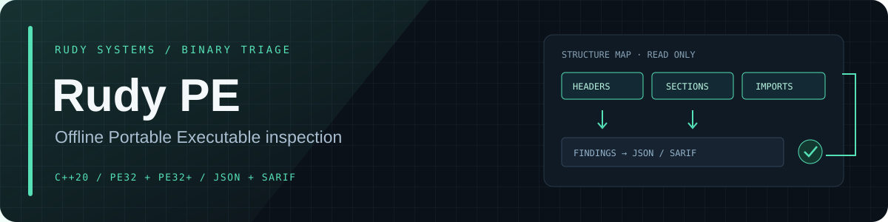

<div align="center">



[](https://isocpp.org/)
[](https://github.com/r4venrudy/rudy-pe/actions)
[](LICENSE)
[](#build)

**Inspect Windows binaries without executing them.**

Rudy PE is a fast, dependency-free C++20 command-line inspector for Portable Executable files. It maps headers and sections, enumerates imports, measures section entropy, checks certificate-table structure, and reports suspicious structural properties as readable text, JSON, or SARIF.

[Features](#features) · [Build](#build) · [Usage](#usage) · [Interpretation](#interpretation) · [Security](SECURITY.md)

</div>

---

## Features

| Area | What it reports |
| --- | --- |
| PE structure | DOS/COFF/optional headers, architecture, bitness, subsystem, entry point, DLL flag, and sections |
| Imports and exports | Import DLLs and named or ordinal symbols; exported-function count |
| Section checks | Out-of-file and overlapping ranges, duplicate names, writable + executable sections, and entry points outside executable sections |
| Triage clues | Per-section Shannon entropy, trailing data, and structurally parsed Authenticode certificate records |
| Automation | Human-readable text, JSON, and SARIF 2.1.0 output |
| Safe parsing | Bounds-checked reads, capped section/import traversal, and a 1 GiB input limit in the CLI |

The parser supports PE32 and PE32+ images and reads the input strictly as bytes. It never loads, maps, or executes the target file.

## Quick start

```text
rudy-pe suspicious.exe
rudy-pe --format json suspicious.exe > report.json
rudy-pe --format sarif suspicious.exe > report.sarif
```

To create a harmless synthetic PE file for a quick demo, run `python examples/create_minimal_pe.py sample.exe` and inspect it with the commands above. The generated file is test data and is not intended to be executed.

`rudy-pe` uses exit code `0` when it creates a report, `1` for command-line or I/O errors, and `2` when the file does not have a parseable PE header.

## Build

Requirements: CMake 3.20+, a C++20 compiler, and Python 3 for the integration test suite.

```sh
cmake -S . -B build -DCMAKE_BUILD_TYPE=Release
cmake --build build --config Release
ctest --test-dir build --build-config Release --output-on-failure
```

The executable is `build/rudy-pe` on Linux/macOS and `build/Release/rudy-pe.exe` with Visual Studio. Install it with:

```sh
cmake --install build --prefix "$HOME/.local"
```

Disable warning-as-error checks only when needed for an unusual compiler: `-DRUDY_PE_WARNINGS_AS_ERRORS=OFF`.

For parser fuzzing, configure with Clang and `-DRUDY_PE_BUILD_FUZZER=ON`, then run `rudy-pe-fuzzer <corpus-directory> -runs=10000`. The CI job runs a seeded smoke test.

## Usage

```text
rudy-pe [--format text|json|sarif] <file.exe|file.dll>
rudy-pe --help
```

Example text output:

```text
Rudy PE | AMD64 64-bit image
File size: 16384 bytes | entry point: 00001000 | trailing bytes: 0
Certificate table: 1536 bytes, 1 structurally valid entries (presence is not signature validation)
Sections (3):
  .text    RVA 00001000 raw 8192 bytes, entropy 6.12
  .rdata   RVA 00003000 raw 4096 bytes, entropy 4.81
  .data    RVA 00004000 raw 2048 bytes, entropy 3.27
Imports: 42 | exported functions: 0
```

The example is illustrative; values vary by file. SARIF results can be uploaded to code-scanning systems that accept SARIF 2.1.0.

## Interpretation

Findings are structural triage signals, not malware verdicts. High entropy can indicate compression or packing, and writable + executable memory can have legitimate uses. A certificate-table entry only confirms that the record is structurally present: Rudy PE does **not** verify Authenticode signatures, evaluate trust chains, unpack files, emulate execution, or identify malware. Confirm findings with trusted signature-validation and endpoint-security tools.

The PE format’s Certificate Table directory address is a file offset, unlike ordinary data-directory RVAs. Rudy PE handles it as such and checks `WIN_CERTIFICATE` record boundaries and eight-byte entry alignment; it does not parse or trust the certificate payload. See [Microsoft PE Format](https://learn.microsoft.com/en-us/windows/win32/debug/pe-format).

## Project layout

```text
include/rudy_pe/pe.hpp  Public parser and report API
src/pe.cpp             Bounds-checked PE parser and formatters
src/main.cpp           Small CLI and bounded file reader
examples/              Safe synthetic PE fixture generator
tests/                 Synthetic parser fixtures, CLI checks, and fuzzer entry point
```

## Safety and scope

Use it on files you are authorized to inspect. Rudy PE does not execute or modify input files, contact network services, or install a driver. See [SECURITY.md](SECURITY.md) for the supported report process and known limits.

---

<div align="center">

Built by **RUDY SYSTEMS** · Local analysis. Clear evidence.

</div>
